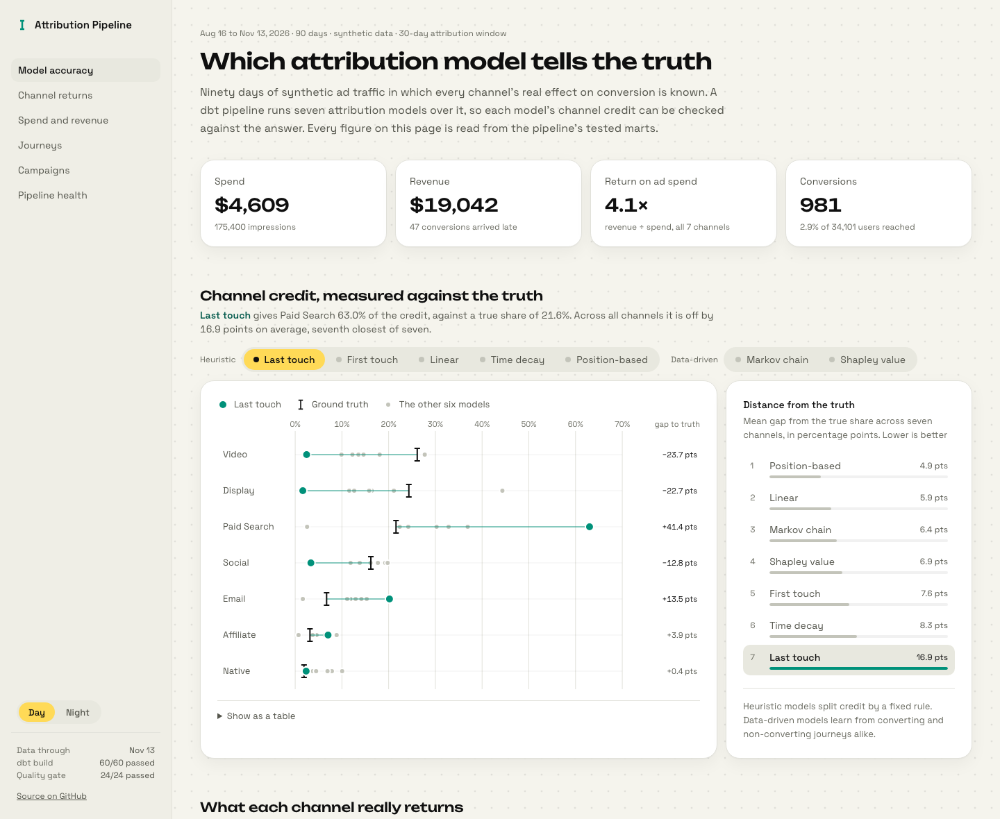
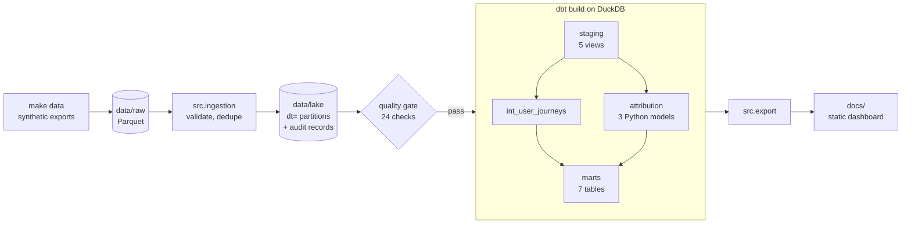

# Ads Attribution Pipeline

[](https://github.com/Pranavmodem/ads-attribution-metrics-pipeline/actions/workflows/ci.yml)

**Live dashboard:** [pranavmodem.github.io/ads-attribution-metrics-pipeline](https://pranavmodem.github.io/ads-attribution-metrics-pipeline/)

A batch pipeline that ingests ad impressions, clicks, and conversions, runs seven
attribution models inside a dbt project on DuckDB, and scores every model against
the known answer of a synthetic dataset. One command runs it end to end on a
laptop; the same steps run as an Airflow DAG.



## Why ground truth

Attribution models are usually compared with each other, because on real data no
one knows which channel actually caused a conversion. This project generates data
where the answer is known. Each simulated user converts with a probability set by
a logistic model of the channels that reached them, so every channel's true share
of the incremental conversions can be computed exactly. Then each model's
channel credit can be measured against the truth instead of argued about.

## What the models get wrong

Mean distance of each model's channel shares from the true shares, in percentage
points, averaged over five random seeds (90 days, about 175,000 impressions and
950 conversions each):

| Model | Family | Error vs truth | Rank in every seed |
| --- | --- | --- | --- |
| Position-based (40/20/40) | heuristic | 5.1 pts | 1st |
| Linear | heuristic | 6.1 pts | 2nd |
| Markov chain (removal effect) | data-driven | 6.4 pts | 3rd or 4th |
| Shapley value (over a fitted conversion model) | data-driven | 7.2 pts | 3rd to 5th |
| First touch | heuristic | 7.2 pts | 4th or 5th |
| Time decay (7-day half-life) | heuristic | 8.4 pts | 6th |
| Last touch | heuristic | 17.0 pts | 7th |

What the live dashboard's run (seed 42) shows:

- **Last touch gives Paid Search 63% of the credit. Its true share is 22%.**
  Search sits at the end of most journeys, so it collects credit for conversions
  that Display and Video started.
- **Last touch says Display returns 1.1× on spend. It returns 16.9×.** Video: 0.8×
  against a true 8.2×. A budget moved on last-touch ROAS would cut the two most
  efficient channels.
- **The data-driven models do not win here.** Position-based lands closest
  because the three channels with the largest true shares (Video, Display, and
  Paid Search) sit at the two ends of a journey, which is the shape a 40/20/40
  rule rewards. Shapley fits main effects only, so it loads the extra lift that
  Paid Search earns after Display or Video onto Paid Search alone. Markov removal
  effects track how often a channel sits on converting paths more than how much
  it adds. On data shaped differently the order would change, which is the point:
  no rule is right in general, and a ground truth is the only way to tell.

## Architecture



Airflow runs the same commands as tasks: four parallel loads, the quality gate,
`dbt build`, and the export. `dags/ads_attribution_dag.py` targets Airflow 3 and
loads one day's partition per run.

| Stage | What it does |
| --- | --- |
| Generate | Simulates about 34,000 users' journeys across 7 channels and 20 campaigns. Plants defects: 0.2% duplicate impressions, re-sent conversions, and 4% of conversions arriving two to five days late. |
| Ingest | Validates each export and writes `data/lake/<entity>/dt=YYYY-MM-DD/`. Conversions are partitioned by the day they arrived, so late events land in a later partition instead of rewriting history. Every partition is overwritten whole, so reruns are safe, and an audit record counts what was loaded and set aside. |
| Quality gate | Schema, completeness, key uniqueness, value ranges, late-arrival share, freshness, and day-over-day volume (z-score against the trailing 14 days). Error-level failures exit 1 and stop the run; warnings are reported. |
| dbt build | Staging views deduplicate across partitions. Three dbt Python models run the attribution code in `src/metrics`. Marts serve daily, campaign, channel, journey, and audit views. 44 tests run in the same build. |
| Export | Writes `docs/data/dashboard.json` from the marts and the dbt run results. The dashboard reads nothing else. |

`LAKE_ROOT` can point at `gs://` or `s3://` (with `gcsfs` or `s3fs` installed); the
loader writes through pandas, and DuckDB reads the same layout.

## Run it

Needs Python 3.11 or newer. Nothing else to install or provision.

```bash
make setup      # .venv with pandas, DuckDB, dbt-duckdb
make pipeline   # generate -> ingest -> quality gate -> dbt build -> export (about 20 s)
make serve      # dashboard at http://localhost:8000
make test       # 45 unit tests
```

Each stage also runs on its own:

```bash
python -m src.ingestion --entity conversions --date 2026-11-13   # one partition
python -m src.utils.quality_checks --date 2026-11-13               # gate one day
dbt build --project-dir . --profiles-dir .                         # models and tests
```

### With Airflow

Airflow needs its own environment, installed with its constraints file:

```bash
python3 -m venv ~/airflow-venv
~/airflow-venv/bin/pip install "apache-airflow==3.4.0" --constraint https://raw.githubusercontent.com/apache/airflow/constraints-3.4.0/constraints-3.11.txt
```

```bash
make data ingest
export AIRFLOW_HOME=$PWD/airflow_home AIRFLOW__CORE__DAGS_FOLDER=$PWD/dags AIRFLOW__CORE__LOAD_EXAMPLES=False
~/airflow-venv/bin/airflow db migrate
~/airflow-venv/bin/airflow dags test ads_attribution_pipeline "$(date -u +%F)"
```

CI runs both: lint, unit tests, and `make pipeline` in one job, and a full
`airflow dags test` in another.

## The models

| Model | How it splits credit |
| --- | --- |
| Last touch | All of it to the last impression before the conversion |
| First touch | All of it to the first impression in the 30-day window |
| Linear | Evenly across every impression in the window |
| Time decay | Halves for every 7 days between impression and conversion |
| Position-based | 40% first, 40% last, 20% split across the middle |
| Markov chain | Builds a transition matrix from converting and non-converting paths, solves P(conversion) as an absorbing chain, and credits each channel by how much that probability drops when the channel is removed |
| Shapley value | Fits P(convert given which channels reached the user) with a logistic regression on every user, then splits each user's predicted lift across their channels with exact Shapley values |

Both data-driven models learn from non-converting journeys. Without them a Markov
chain cannot see that a channel leads nowhere, and the common "simplified" Shapley
formula, which counts only converting journeys, reduces exactly to an even
split across each journey's distinct channels. Converting and non-converting paths use the
same 30-day lookback; windowing only one side biases long-running upper-funnel
channels downward.

## Layout

```
src/
  utils/data_generator.py     synthetic journeys, true conversion model, ground truth
  ingestion/                  lake loader and CLI
  utils/quality_checks.py     quality gate and CLI
  metrics/attribution.py      heuristic models (vectorised)
  metrics/advanced_attribution.py   journeys, Markov, Shapley, position-based
  metrics/compare.py          runs all seven on the same data
  export.py                   marts -> docs/data/dashboard.json
models/                       dbt: staging, intermediate, attribution (Python), marts
tests/                        pytest suites; tests/dbt holds dbt's singular tests
dags/                         Airflow 3 DAG
docs/                         the dashboard (static HTML, CSS, and JS) and architecture notes
```

## Limits

- The data is synthetic. The ground truth is only as realistic as the generator's
  conversion model: logistic in exposures, with diminishing returns to frequency
  and one Display or Video × Paid Search interaction.
- Campaign-level credit comes from the four touchpoint models. Markov and
  Shapley credit channels, not individual impressions.
- The warehouse is one DuckDB file, so one writer at a time. The DAG allows a
  single active run for that reason.
